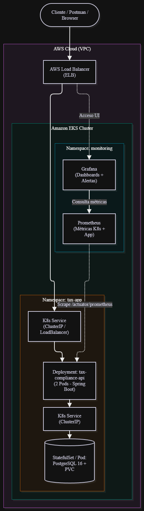
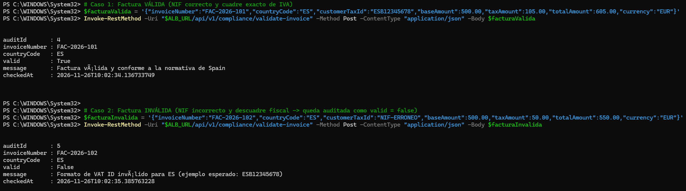
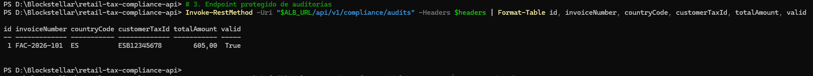
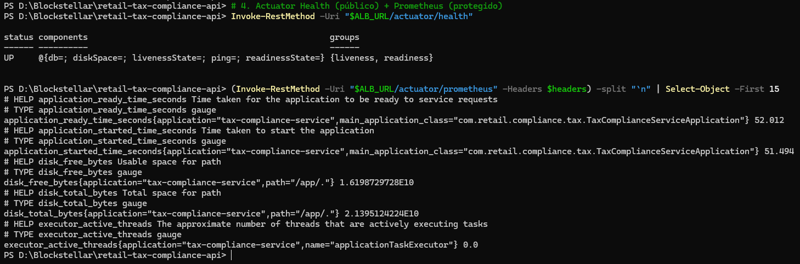

# Retail Tax & Compliance API (`tax-compliance-service`)

Microservicio REST cloud-native desarrollado con **Java 21** y **Spring Boot 3** para el cálculo automatizado de impuestos indirectos (IVA/VAT) y validación de facturación internacional en operaciones de comercio minorista (*retail*), con persistencia en **PostgreSQL 16**, pipeline CI/CD en **GitHub Actions**, despliegue automatizado en **AWS EKS** mediante **Terraform** y **Kubernetes**, y observabilidad en tiempo real con **Prometheus** y **Grafana**.

> **Alcance del Proyecto:** Este sistema constituye una **prueba de concepto tecnológica (PoC)** centrada en un conjunto acotado de países europeos (`ES`, `FR`, `DE`, `PT`) y reglas fiscales representativas. No sustituye a una solución certificada de cumplimiento tributario en producción.

---

## Arquitectura del Sistema

La arquitectura separa responsabilidades mediante dos namespaces aislados dentro de **Amazon EKS (`eu-west-1`)**:

* **`tax-app`:** Ejecuta 2 réplicas del microservicio `tax-compliance-api` detrás de un **AWS Load Balancer (ELB)** público, conectadas por red interna (`ClusterIP`) a un `StatefulSet` de **PostgreSQL 16** respaldado por almacenamiento persistente **AWS EBS CSI (`gp2`)**. *(Nota de diseño: para esta demo se despliega PostgreSQL dentro del clúster para optimizar costes; en un entorno productivo de alta disponibilidad se valoraría migrar a **Amazon RDS**).*
* **`monitoring`:** Ejecuta `kube-prometheus-stack` (Prometheus + Grafana). Prometheus recolecta métricas autenticadas desde `/actuator/prometheus` mediante un `ServiceMonitor` con `basicAuth`. **Grafana permanece aislado en red interna (`ClusterIP`)** sin exposición pública, accediendo exclusivamente mediante túnel cifrado (`kubectl port-forward`).

---

## Seguridad, Automatización y FinOps

* **Seguridad Aplicada:**
    * Endpoints sensibles (`/api/v1/compliance/audits` y `/actuator/prometheus`) protegidos mediante **Spring Security (HTTP Basic Auth)** con credenciales inyectadas desde **Kubernetes Secrets** (sin credenciales hardcodeadas en el repositorio).
    * Imagen Docker multi-stage ejecutada bajo usuario sin privilegios (`spring`).
    * Principio de mínimo privilegio en los roles IAM de EKS (`AmazonEBSCSIDriverPolicy`).
* **CI/CD con GitHub Actions:** Cada `push` a `main` ejecuta automáticamente los tests unitarios con Maven y H2, construye la imagen Docker y la publica en DockerHub (`romeroperezpaula/tax-compliance-service:latest` y tag por SHA de commit).
* **Control FinOps:** Desarrollo local-primero con Docker Compose, presupuesto configurado en **AWS Budgets ($15.00 USD)** con alertas al 80 % y destrucción completa de infraestructura tras las pruebas (`terraform destroy`).

---

## Endpoints Principales

| Método | Ruta | Acceso | Descripción |
| :--- | :--- | :--- | :--- |
| `GET` | `/api/v1/tax-rules/{countryCode}` | Público | Consulta los tipos impositivos y regex fiscal vigentes (`ES`, `FR`, `DE`, `PT`) |
| `POST` | `/api/v1/tax/calculate` | Público | Calcula el IVA aplicable y el importe total según país, `baseAmount` y `productCategory` |
| `POST` | `/api/v1/compliance/validate-invoice` | Público | Valida una factura (formato NIF/VAT y cuadre fiscal) y registra la auditoría en PostgreSQL |
| `GET` | `/api/v1/compliance/audits` | **Basic Auth** | Lista el historial de auditorías registradas |
| `GET` | `/actuator/health` | Público | Estado de salud (`liveness` y `readiness`) para las sondas de Kubernetes |
| `GET` | `/actuator/prometheus` | **Basic Auth** | Métricas JVM, CPU y latencia HTTP en formato Prometheus |

---

## Guía de Despliegue

### 1. Ejecución en Local (Maven + PostgreSQL)

    docker compose up -d postgres
    cd app
    ./mvnw spring-boot:run

La API estará disponible en `http://localhost:8080`.

### 2. Ejecución con Docker y Docker Compose

    docker compose up --build -d
    docker compose ps
    curl http://localhost:8080/api/v1/tax-rules/ES

Para detener y limpiar el entorno local:

    docker compose down -v

### 3. Despliegue en AWS EKS con Terraform, Kubernetes y Prometheus/Grafana

**A. Provisionar VPC y clúster EKS con Terraform:**

    cd terraform
    terraform init
    terraform apply -auto-approve

**B. Conectar `kubectl` y desplegar la aplicación (`tax-app`):**

    aws eks --region eu-west-1 update-kubeconfig --name retail-tax-eks
    cd ..
    kubectl apply -f k8s/
    kubectl get pods -n tax-app
    kubectl get svc tax-compliance-service -n tax-app

**C. Instalar Prometheus y Grafana (`monitoring`):**

    helm repo add prometheus-community https://prometheus-community.github.io/helm-charts
    helm repo update
    helm install prometheus-stack prometheus-community/kube-prometheus-stack --namespace monitoring --create-namespace
    kubectl create secret generic prometheus-scrape-secret -n monitoring --from-literal=username=admin --from-literal=password=TaxCompliance2026!
    kubectl apply -f monitoring/servicemonitor-and-alert.yaml

**D. Acceso seguro a Grafana (túnel interno):**

    kubectl port-forward -n monitoring svc/prometheus-stack-grafana 3000:80

Accede a `http://localhost:3000` (usuario `admin`, contraseña almacenada en el secret `prometheus-stack-grafana` del namespace `monitoring`) e importa el dashboard **19004** (*Spring Boot 3.x Statistics*).

**E. Limpieza de recursos en AWS (FinOps):**

    kubectl delete -f k8s/ --ignore-not-found
    cd terraform
    terraform destroy -auto-approve

---

## Evidencias del Despliegue y Validación

### 1. Pipeline CI/CD y Registro de Contenedores

### 2. Control Presupuestario FinOps (AWS Budgets)

### 3. Provisión en AWS EKS y Orquestación Kubernetes

### 4. Pruebas End-to-End (Endpoints Públicos y Autenticados)
* **Consulta de reglas fiscales (`GET /api/v1/tax-rules/{countryCode}`):**
  

* **Cálculo de impuestos (`POST /api/v1/tax/calculate`):**
  

* **Validación de facturas (`POST /api/v1/compliance/validate-invoice`):**
  

* **Historial de auditorías protegido con HTTP Basic Auth (`GET /api/v1/compliance/audits`):**
  

* **Healthchecks y métricas protegidas de Actuator (`/actuator/health` y `/actuator/prometheus`):**
  

### 5. Observabilidad y Alertas en Tiempo Real (Prometheus & Grafana)

---

## Estructura del Repositorio

    retail-tax-compliance-api/
    ├── .github/workflows/      # Pipeline CI/CD automatizado con GitHub Actions
    ├── app/                    # Código fuente Java 21 / Spring Boot 3, tests unitarios y Dockerfile
    ├── k8s/                    # Manifiestos de Kubernetes (Namespace, ConfigMap, Secrets, Postgres StatefulSet, API Deployment)
    ├── terraform/              # Infraestructura como Código en AWS (VPC, Subredes, IAM mínimo privilegio, EKS Cluster)
    ├── monitoring/             # ServiceMonitor autenticado y PrometheusRule para alertas
    ├── docs/                   # Diagrama de arquitectura y capturas de despliegue/validación
    └── docker-compose.yml      # Orquestación local de desarrollo