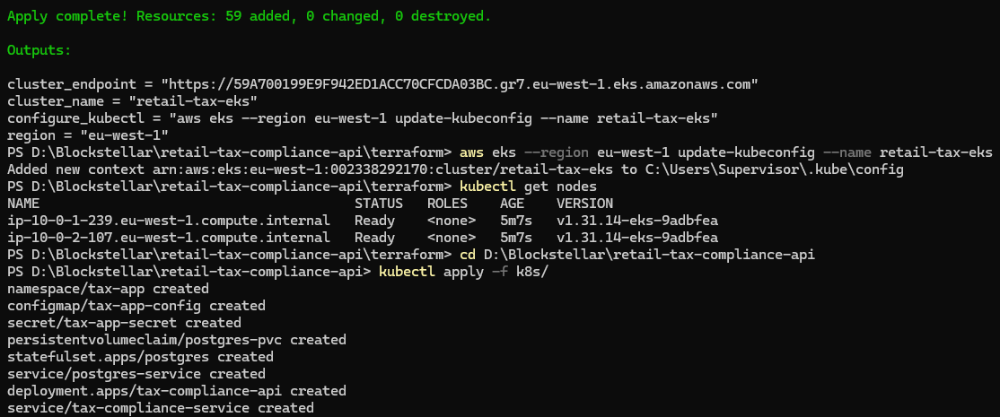
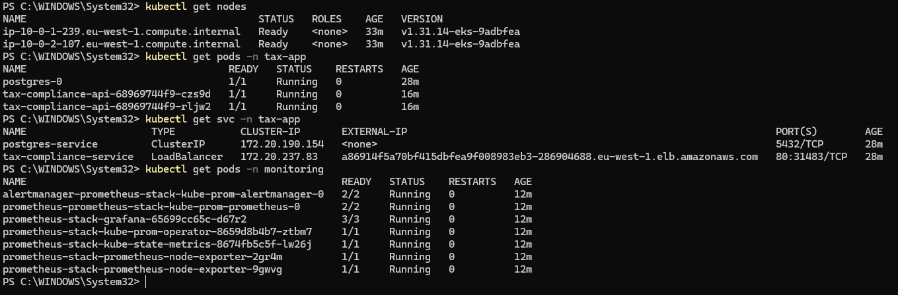
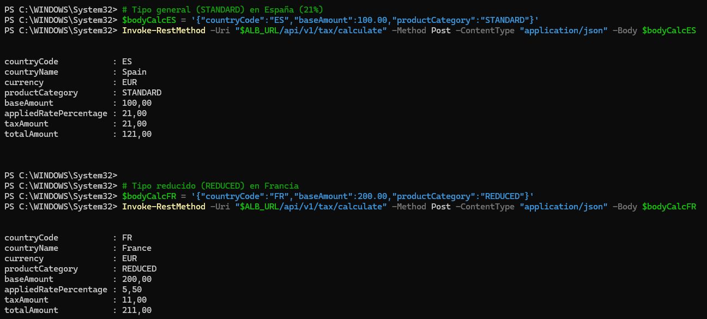
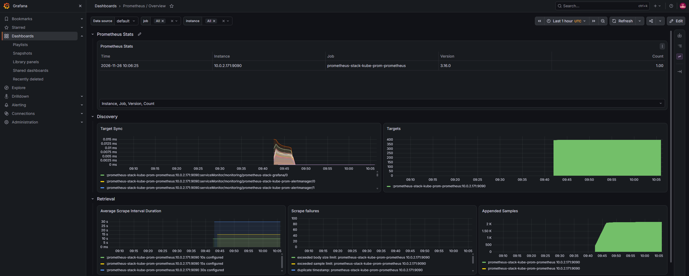
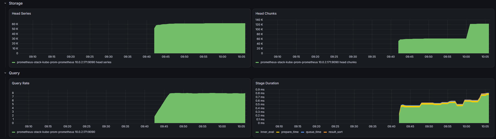
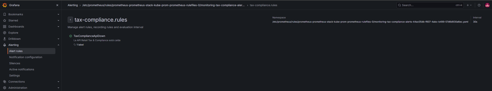

# Retail Tax & Compliance API (`tax-compliance-service`)

Microservicio REST cloud-native desarrollado con **Java 21** y **Spring Boot 3** para el cálculo automatizado de impuestos indirectos (IVA/VAT) y validación de facturación internacional en operaciones de comercio minorista (*retail*), con persistencia en **PostgreSQL 16**, despliegue automatizado en **AWS EKS** mediante **Terraform** y **Kubernetes**, y observabilidad en tiempo real con **Prometheus** y **Grafana**.

---

## Arquitectura del Sistema

El sistema sigue una arquitectura desacoplada y escalable sobre Amazon EKS dividida en dos namespaces aislados:
* **`tax-app`:** Expone el microservicio `tax-compliance-api` (2 réplicas detrás de un AWS Load Balancer) conectado por red interna (`ClusterIP`) a un `StatefulSet` de PostgreSQL 16 con volumen persistente EBS (`gp2`).
* **`monitoring`:** Ejecuta el stack de observabilidad (`kube-prometheus-stack`), recolectando métricas mediante un `ServiceMonitor` desde `/actuator/prometheus` y evaluando reglas de alerta personalizadas (`PrometheusRule`).

---

## Stack Tecnológico

* **Backend:** Java 21, Spring Boot 3 (Spring Web, Spring Data JPA, Validation, Actuator + Micrometer Prometheus)
* **Base de Datos:** PostgreSQL 16 (`postgres:16-alpine`) con almacenamiento persistente EBS (`gp2`)
* **Contenedorización:** Docker (build multi-stage) y DockerHub (`romeroperezpaula/tax-compliance-service:1.0.0`)
* **Infraestructura como Código (IaC):** Terraform (`terraform-aws-modules/vpc/aws` y `terraform-aws-modules/eks/aws` en `eu-west-1`)
* **Orquestación:** Kubernetes en Amazon EKS (Namespaces, ConfigMaps, Secrets, StatefulSets, PVCs, Deployments con Liveness/Readiness probes, Services LoadBalancer/ClusterIP)
* **Observabilidad y Alertas:** `kube-prometheus-stack` (Helm), `ServiceMonitor` personalizado y `PrometheusRule`

---

## Endpoints Principales

| Método | Ruta | Descripción |
| :--- | :--- | :--- |
| `GET` | `/api/v1/tax-rules/{countryCode}` | Consulta los tipos impositivos vigentes y regex de validación fiscal por país (`ES`, `FR`, `DE`, `PT`) |
| `POST` | `/api/v1/tax/calculate` | Calcula el impuesto aplicable y el importe total según país, base imponible (`baseAmount`) y categoría (`productCategory`) |
| `POST` | `/api/v1/compliance/validate-invoice` | Valida una factura (formato NIF/VAT y cuadre de importes) y registra la auditoría en PostgreSQL |
| `GET` | `/api/v1/compliance/audits` | Lista el historial de auditorías registradas |
| `GET` | `/actuator/health` | Estado de salud del microservicio (`liveness` y `readiness`) |
| `GET` | `/actuator/prometheus` | Métricas JVM, CPU y tráfico HTTP en formato Prometheus |

---

## Guía de Despliegue

### 1. Ejecución en Local (Maven + PostgreSQL)

1. Arranca únicamente la base de datos PostgreSQL con Docker:

       docker compose up -d postgres

2. Ejecuta la aplicación Spring Boot:

       ./mvnw spring-boot:run

3. La API estará disponible en `http://localhost:8080`.

---

### 2. Ejecución con Docker y Docker Compose

1. Levanta todo el entorno (API + PostgreSQL) construyendo la imagen multi-stage:

       docker compose up --build -d

2. Comprueba los contenedores activos y prueba un endpoint:

       docker compose ps
       curl http://localhost:8080/api/v1/tax-rules/ES

3. Para detener y limpiar el entorno local:

       docker compose down -v

*(Imagen pública disponible en DockerHub: `docker pull romeroperezpaula/tax-compliance-service:1.0.0`)*

---

### 3. Despliegue en AWS EKS con Terraform, Kubernetes y Prometheus/Grafana

#### A. Provisionar la infraestructura con Terraform

    cd terraform
    terraform init
    terraform apply -auto-approve

#### B. Conectar `kubectl` y desplegar la aplicación (`tax-app`)

    aws eks --region eu-west-1 update-kubeconfig --name retail-tax-eks
    cd ..
    kubectl apply -f k8s/
    kubectl get pods -n tax-app
    kubectl get svc tax-compliance-service -n tax-app

#### C. Instalar Prometheus y Grafana (`monitoring`)

    helm repo add prometheus-community https://prometheus-community.github.io/helm-charts
    helm repo update
    helm install prometheus-stack prometheus-community/kube-prometheus-stack --namespace monitoring --create-namespace
    kubectl apply -f monitoring/servicemonitor-and-alert.yaml

#### D. Acceso a Grafana en tiempo real

    kubectl port-forward -n monitoring svc/prometheus-stack-grafana 3000:80

Accede a `http://localhost:3000` (usuario `admin`; contraseña almacenada en el secret `prometheus-stack-grafana` del namespace `monitoring`) e importa el dashboard **19004** (*Spring Boot 3.x Statistics*).

#### E. Limpieza de recursos en AWS (FinOps)

    kubectl delete -f k8s/ --ignore-not-found
    cd terraform
    terraform destroy -auto-approve

---

## Evidencias del Despliegue y Validación

### 1. Imagen Publicada en DockerHub

### 2. Provisión de Infraestructura con Terraform

### 3. Clúster EKS, Pods y Servicios Activos

### 4. Pruebas End-to-End contra el AWS Load Balancer
* **Consulta de reglas fiscales por país:**
  
* **Cálculo de impuestos (`STANDARD` / `REDUCED`):**
  
* **Validación de facturas y registro en PostgreSQL:**
  
* **Historial de auditorías almacenadas:**
  
* **Healthchecks y métricas de Actuator:**
  

### 5. Observabilidad y Alertas en Tiempo Real (Prometheus & Grafana)
* **Dashboard Spring Boot 3.x Statistics:**
  
* **Vista general de Prometheus y Almacenamiento:**
  
  
* **Regla de Alerta Personalizada (`TaxComplianceApiDown`):**
  

---

## Estructura del Repositorio

    retail-tax-compliance-api/
    ├── src/                        # Código fuente Java 21 / Spring Boot 3
    ├── k8s/                        # Manifiestos de Kubernetes (Namespace, ConfigMap, Secret, Postgres StatefulSet, API Deployment, Services)
    ├── terraform/                  # Infraestructura como Código en AWS (VPC, Subredes, IAM, EKS Cluster + Node Group)
    ├── monitoring/                 # ServiceMonitor y PrometheusRule para observabilidad y alertas
    ├── docs/                       # Diagrama de arquitectura y capturas de despliegue en AWS/Grafana
    ├── Dockerfile                  # Build multi-stage optimizado con JRE 21 Alpine
    ├── docker-compose.yml          # Orquestación local de desarrollo
    └── pom.xml                     # Dependencias Maven (Spring Web, JPA, PostgreSQL, Actuator, Micrometer)