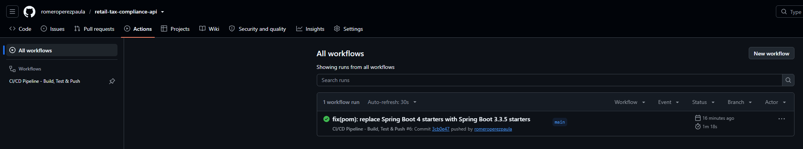
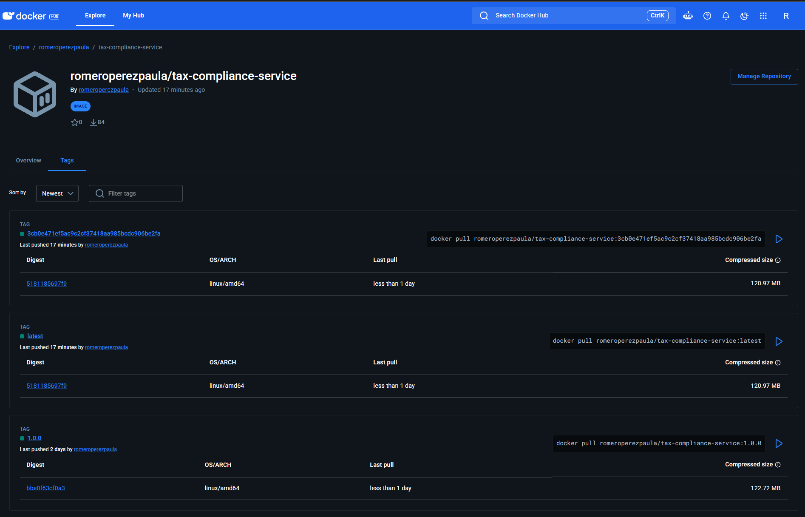
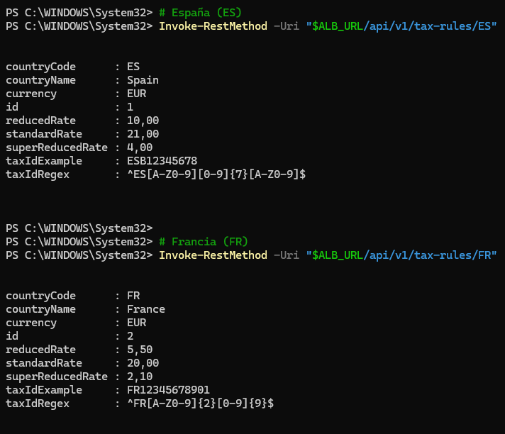
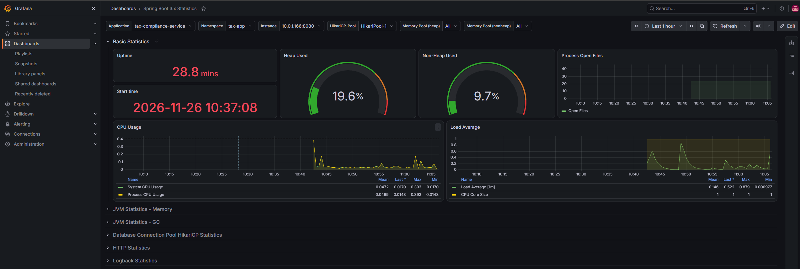
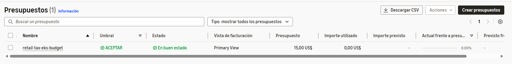

# Retail Tax & Compliance API (`tax-compliance-service`)

Microservicio REST cloud-native desarrollado con **Java 21** y **Spring Boot 3** para el cálculo automatizado de impuestos indirectos (IVA/VAT) y validación de facturación internacional en operaciones de comercio minorista (*retail*), con persistencia en **PostgreSQL 16**, despliegue automatizado en **AWS EKS** mediante **Terraform** y **Kubernetes**, pipeline **CI/CD con GitHub Actions** y observabilidad en tiempo real con **Prometheus** y **Grafana**.

> **Nota de Alcance:** Este proyecto constituye una **demostración tecnológica (Proof of Concept)** orientada a arquitectura Cloud y DevOps. Opera con un conjunto acotado de países (`ES`, `FR`, `DE`, `PT`) y reglas fiscales básicas, sin constituir una solución certificada de cumplimiento tributario oficial.

---

## Arquitectura del Sistema


El sistema sigue una arquitectura desacoplada sobre **Amazon EKS** en una única región (`eu-west-1`) dividida en dos namespaces aislados:

* **`tax-app`:** Expone el microservicio `tax-compliance-api` (2 réplicas detrás de un AWS Load Balancer) conectado por red interna (`ClusterIP`) a un `StatefulSet` de PostgreSQL 16 respaldado por almacenamiento persistente EBS (`gp2`) gestionado mediante el driver `aws-ebs-csi-driver`.
    * *Decisión de arquitectura:* Se despliega PostgreSQL dentro del clúster para optimizar costes en el entorno de demostración; en un escenario productivo se migraría a **Amazon RDS** gestionado con alta disponibilidad Multi-AZ.
* **`monitoring`:** Ejecuta el stack de observabilidad (`kube-prometheus-stack`), recolectando métricas autenticadas mediante un `ServiceMonitor` desde `/actuator/prometheus` y evaluando reglas de alerta personalizadas (`PrometheusRule`).

---

## Seguridad, CI/CD y FinOps

* **Seguridad de Endpoints y Credenciales:**
    * Los endpoints de auditoría (`/api/v1/compliance/audits`) y métricas (`/actuator/prometheus`) están protegidos mediante **Spring Security (HTTP Basic)** con credenciales inyectadas desde `Secrets` de Kubernetes (`tax-app-secret` y `prometheus-scrape-secret`), sin credenciales almacenadas en el repositorio.
    * **Grafana** permanece aislado en red interna (`ClusterIP`) sin exposición pública a Internet, accediendo únicamente mediante túnel cifrado (`kubectl port-forward`).
    * **Principio de mínimo privilegio en IAM:** El grupo de nodos de EKS limita sus políticas adicionales exclusivamente a `AmazonEBSCSIDriverPolicy` para la gestión de volúmenes persistentes.
* **Automatización CI/CD (GitHub Actions):**
    * Workflow `.github/workflows/ci-cd.yml` que ejecuta automáticamente los tests unitarios con Maven y base de datos en memoria H2, construye la imagen Docker multi-stage y la publica en DockerHub (`romeroperezpaula/tax-compliance-service:latest` y tag por SHA de commit) en cada `push` a `main`.
* **Gestión de Costes (FinOps):**
    * Desarrollo y pruebas iniciales 100 % en local con Docker Compose, desplegando en AWS únicamente durante la fase de validación y grabación.
    * Alerta presupuestaria configurada en **AWS Budgets** ($15.00 USD/mes) y destrucción completa de recursos mediante `terraform destroy` verificando ausencia de volúmenes EBS o Load Balancers residuales.

---

## Stack Tecnológico

* **Backend:** Java 21, Spring Boot 3.3.5 (Spring Web, Spring Data JPA, Spring Security, Validation, Actuator + Micrometer Prometheus)
* **Base de Datos:** PostgreSQL 16 (`postgres:16-alpine`) con almacenamiento persistente EBS (`gp2`) + H2 para tests CI
* **Contenedorización y CI/CD:** Docker (build multi-stage), DockerHub y GitHub Actions
* **Infraestructura como Código (IaC):** Terraform (`terraform-aws-modules/vpc/aws` y `terraform-aws-modules/eks/aws` en `eu-west-1`)
* **Orquestación:** Kubernetes en Amazon EKS (Namespaces, ConfigMaps, Secrets, StatefulSets, PVCs, Deployments con Liveness/Readiness probes, Services LoadBalancer/ClusterIP)
* **Observabilidad y Alertas:** `kube-prometheus-stack` (Helm), `ServiceMonitor` autenticado y `PrometheusRule`

---

## Endpoints Principales

| Método | Ruta | Acceso | Descripción |
| :--- | :--- | :--- | :--- |
| `GET` | `/api/v1/tax-rules/{countryCode}` | Público | Consulta los tipos impositivos vigentes y regex de validación fiscal por país (`ES`, `FR`, `DE`, `PT`) |
| `POST` | `/api/v1/tax/calculate` | Público | Calcula el impuesto aplicable y el importe total según país, `baseAmount` y `productCategory` |
| `POST` | `/api/v1/compliance/validate-invoice` | Público | Valida una factura (formato NIF/VAT y cuadre de importes) y registra la auditoría en PostgreSQL |
| `GET` | `/api/v1/compliance/audits` | Protegido (Basic Auth) | Lista el historial de auditorías registradas |
| `GET` | `/actuator/health` | Público | Estado de salud del microservicio (`liveness` y `readiness`) |
| `GET` | `/actuator/prometheus` | Protegido (Basic Auth) | Métricas JVM, CPU y tráfico HTTP en formato Prometheus |

---

## Guía de Despliegue

### 1. Ejecución en Local (Maven + PostgreSQL)

1. Arranca únicamente la base de datos PostgreSQL con Docker:
   ```bash
   docker compose up -d postgres
   ```
2. Ejecuta la aplicación Spring Boot desde `app/`:
   ```bash
   cd app
   ./mvnw spring-boot:run
   ```
3. La API estará disponible en `http://localhost:8080`.

### 2. Ejecución con Docker y Docker Compose

1. Levanta todo el entorno (API + PostgreSQL) construyendo la imagen multi-stage:
   ```bash
   docker compose up --build -d
   ```
2. Comprueba los contenedores activos y prueba un endpoint:
   ```bash
   docker compose ps
   curl http://localhost:8080/api/v1/tax-rules/ES
   ```
3. Para detener y limpiar el entorno local:
   ```bash
   docker compose down -v
   ```

*(Imagen pública disponible en DockerHub: `docker pull romeroperezpaula/tax-compliance-service:latest`)*

### 3. Despliegue en AWS EKS con Terraform, Kubernetes y Prometheus/Grafana

1. **Provisionar la infraestructura con Terraform:**
   ```bash
   cd terraform
   terraform init
   terraform apply -auto-approve
   ```
2. **Conectar `kubectl` y desplegar la aplicación (`tax-app`):**
   ```bash
   aws eks --region eu-west-1 update-kubeconfig --name retail-tax-eks
   cd ..
   kubectl apply -f k8s/
   kubectl get pods -n tax-app
   kubectl get svc tax-compliance-service -n tax-app
   ```
3. **Instalar Prometheus y Grafana (`monitoring`):**
   ```bash
   helm repo add prometheus-community [https://prometheus-community.github.io/helm-charts](https://prometheus-community.github.io/helm-charts)
   helm repo update
   helm install prometheus-stack prometheus-community/kube-prometheus-stack --namespace monitoring --create-namespace
   kubectl apply -f monitoring/servicemonitor-and-alert.yaml
   ```
4. **Acceso a Grafana en tiempo real:**
   ```bash
   kubectl port-forward -n monitoring svc/prometheus-stack-grafana 3000:80
   ```
   Accede a `http://localhost:3000` (usuario `admin`; contraseña almacenada en el secret `prometheus-stack-grafana` del namespace `monitoring`) e importa el dashboard **19004** (*Spring Boot 3.x Statistics*).
5. **Limpieza de recursos en AWS (FinOps):**
   ```bash
   kubectl delete -f k8s/ --ignore-not-found
   cd terraform
   terraform destroy -auto-approve
   ```

---

## Evidencias del Despliegue, CI/CD y FinOps

### 1. Pipeline CI/CD Automatizado (GitHub Actions & DockerHub)



### 2. Provisión de Infraestructura con Terraform y Clúster EKS


### 3. Pruebas End-to-End contra el AWS Load Balancer



### 4. Observabilidad, Pruebas de Carga y Alertas en Grafana



### 5. Control de Costes (AWS Budgets)


---

## Estructura del Repositorio

```text
retail-tax-compliance-api/
├── .github/workflows/ci-cd.yml # Pipeline CI/CD (tests Maven + H2, build Docker y push a DockerHub)
├── app/                        # Código fuente Java 21 / Spring Boot 3, Spring Security y Dockerfile
├── k8s/                        # Manifiestos de Kubernetes (Namespace, ConfigMap, Secrets, Postgres StatefulSet, API Deployment)
├── terraform/                  # Infraestructura como Código en AWS (VPC, Subredes, IAM mínimo privilegio, EKS Cluster)
├── monitoring/                 # ServiceMonitor con Basic Auth y PrometheusRule para alertas
├── docs/                       # Diagrama de arquitectura y capturas de despliegue, CI/CD, Grafana y AWS Budgets
└── docker-compose.yml          # Orquestación local de desarrollo
```